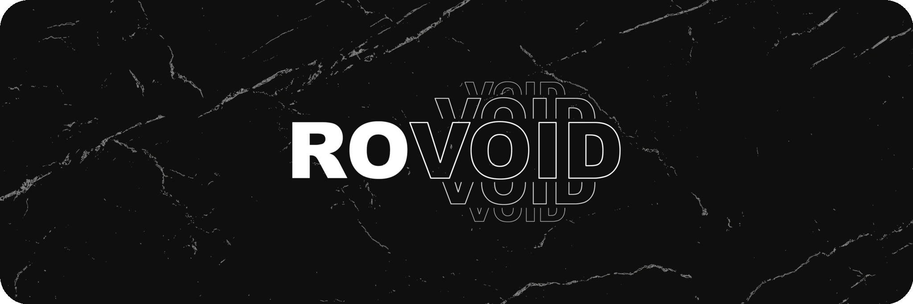

 

  

###

<h3 align="left">About Me</h3>

###

I'm a Full Stack Software Developer specializing in building scalable web applications, desktop software, and cross-platform mobile solutions. I focus on architecting resilient systems, writing maintainable code, and delivering seamless user experiences from the database layer to the client interface.

###

### Multimedia & Technical Arts

Alongside traditional software engineering, I have practical experience in visual media, including building code-driven motion graphics with Remotion, as well as working in Unreal Engine, Adobe Premiere, and After Effects.

<h3 align="left">Technical Stack</h3>

###

  

###

<h3 align="left">My Services</h3>

###

  

###

<h4 align="left">Other Services</h4>

###

  

###

<h3 align="left">My Projects</h3>

###

<h4 align="left">Featured &amp; Flagship Applications</h4>

###

  
  
  

###

<h4 align="left">AI Gateways &amp; Reverse Routers (*2API Suite)</h4>

###

  
  
  
  
  

###

<h4 align="left">Developer Utilities &amp; Mini-Tools</h4>

###

  

###

<h3 align="left">My Stats :</h3>

###

  
  

###

<h3 align="left">Support My Work</h3>

###

If you find my projects and work useful, please consider a donation. As I am based in Iran, cryptocurrency is the only way I can receive support. Thank you!

  
  
  

  
Click here to copy addresses

   
  <b>Bitcoin (BTC):</b> <code>bc1qd35yqx3xt28dy6fd87xzd62cj7ch35p68ep3p8</code> 
  <b>Ethereum (ETH):</b> <code>0xA39Dfd80309e881cF1464dDb00cF0a17bF0322e3</code> 
  <b>USDT (BNB):</b> <code>0xA39Dfd80309e881cF1464dDb00cF0a17bF0322e3</code> 
  <b>USDT (TRC20):</b> <code>THMe6FdXkA2Pw45yKaXBHRnkX3fjyKCzfy</code> 
  <b>TON:</b> <code>UQCp0OawnofpZTNZk-69wlqIx_wQpzKBgDpxY2JK5iynh3mC</code> 
  <b>Solana (SOL):</b> <code>7NoEScTxHnmgKCNDsUGzQs2jZATZMPAz8UdcWko6Y5Gj</code> 

